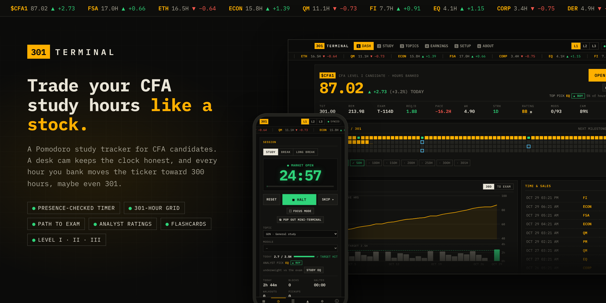

# 301hours



**A CFA study tracker styled as a trading terminal.** Your study hours trade as a stock (`$CFA1`, `$CFA2` or `$CFA3`): every focused hour moves the price up, topics get analyst ratings, and a 301-square grid fills in as you head for the recommended 300 hours, maybe even 301.

The timer is a Pomodoro clock with a desk-cam presence check. The clock only runs while you're actually at your desk, and it halts if you walk away or pick up your phone, so the hours on the board are hours you really studied. Detection runs entirely in your browser; no video leaves your device.

It's free to host yourself on Vercel, syncs across your devices, works for Level I, II and III, and installs like an app on desktop and phone.

## Features

### Track your progress

- **Dashboard** (home page): hours banked against your target, the hours per day you need before exam day, a grid with one square per hour of your target (301 by default) and milestones, a chart with a 30-day view (cumulative hours with daily volume) and a path-to-exam view, a time & sales tape of recent sessions, and a watchlist of topics with week-on-week change.
- **Path to exam** (dashboard chart, `TO EXAM` tab): your actual hours against the straight-line path to your goal on exam day (flat on rest days), with a projection at your last-14-days pace. The PACE figure in the quote strip says how far ahead or behind the path you are today.
- **Milestones**: crossing 10, 25, 50, 100, 150, 200, 250, 300 and 301 hours triggers a breaking-news banner. With a different target, the milestones are spread evenly up to it in round numbers (e.g. 650h: 10, 25, 50, 100, 200 … 600, 650). Changing the target never fires banners for hours you have already passed. Go past the target and the grid header shows how far over you are (`+62.0H OVER TARGET`).
- **Levels**: switch between CFA Level I, II and III in the header. Each level has its own topics, hours and grid. For Level III, pick your pathway (Portfolio Management, Private Wealth or Private Markets) in Topics or Setup.
- **Analyst ratings**: each topic's share of your hours vs its share of the exam: UNDERWEIGHT · BUY, MARKET WEIGHT · HOLD or OVERWEIGHT · TRIM, plus a "top pick" to study next.
- **Credit rating**: AAA–CCC from the last 14 days' consistency, daily-target hits, camera-verified share and streak, with upgrade/downgrade alerts.
- **Heatmap**: the exam as a map. Tiles are sized by exam weight and coloured by hours logged, so a big dark tile is a big part of the exam you haven't covered.
- **Weekly 10-K**: a one-page weekly report, also savable as an image.
- **General study (GEN)**: time logged without a topic counts towards your totals and shows as its own GEN line in the watchlist, ticker and heatmap, but is never rated against the exam.

### Study sessions

- **Study**: a Pomodoro timer with a desk cam. The market is open while you're in frame. Walk away and trading halts until you're back. Breaks don't need the camera. Keys: `Space` open/halt, `S` skip, `R` reset. Blocks and breaks start by themselves (both optional in Setup), with a sound and an in-page alert at each change and a 1-minute warning before each one ends.
- **Phone check**: with the camera on, a phone in frame halts the study clock ("PHONE IN HAND"), and pickups are counted. Switch it off on the Study page or in Setup.
- **Focus mode** (`F`): a full-screen countdown with the desk-cam light and today's target; the screen is kept awake while the timer runs.
- **End-of-block wrap-up**: after each block, optionally rate your focus (1–5), note what you covered, tie it to a module (finishing it is optional) and log practice questions. Turn the whole thing or individual questions off in Setup. Notes show per module on Topics.
- **Study plan**: queue blocks by topic/module on the Study page; each new block loads the next one and finished blocks tick off.
- **Auto-plan today**: one button on the Study page builds today's plan from reviews due, topics underweight against the exam and topics below your score target, with the reason for each block.
- **Rest days** (Setup → Goals): weekdays and specific dates off. They never break your streak or lower your credit rating, and the daily pace only counts study days.
- **Focus sounds**: optional brown noise, rain or trading-floor ambience during study blocks.
- **Mini-terminal**: pop the timer out into an always-on-top window (Chrome/Edge; a small window elsewhere).
- **Tab countdown**: the browser tab shows the running clock (`▶ 18:42 · FI`), so you can see it from another tab.

### Revise and practise

- **Topics**: the curriculum for each level as a checklist. Rename, re-ticker, add or delist anything to match your curriculum year. The Level II and III module lists follow the recent curriculum structure; check them against yours.
- **Revision schedule**: ticked modules come back for review after 1, 7 and 30 days ("maturing" on the dashboard).
- **Flashcards**: your own cards per topic (Topics → FLASHCARDS; add one by one or paste `front | back` lines). They appear during breaks and in focus mode, using a Leitner box system (GOT IT = seen less often, AGAIN = back to box 1).
- **Break gate** (optional, Setup → Flashcards → GATE THE BREAK): the break unlocks only after you answer 1–5 cards (or get them right, in strict mode). It runs after the wrap-up, the break clock waits until you're done, and skipping is allowed but shows in the 10-K.
- **Earnings**: log question-bank sets and mock exams; each one BEATs or MISSes your target score (70% by default), with accuracy per topic and a mock-exam trend.

### Everywhere you study

- **Sync & accounts**: data is saved in the browser and synced to a small database on Vercel. Either sign in with Google (one account per person, so others can use it too) or use a single passcode.
- **Installable**: add it to your dock or home screen; it opens offline, and the timer survives a reload.
- **On a phone**: the pages sit in a bottom tab bar, and alerts pop up bottom-right on desktop, above the tab bar on phones.
- **Themes** (Setup → App): Amber, Phosphor green, Reuters blue or Paper (light).
- **Navigation**: keys `1`–`5` switch between Dashboard, Study, Topics, Earnings and Setup; `6` opens About.

## How the presence check works

The Study page runs Google's MediaPipe person detector (EfficientDet-Lite0) on your webcam twice a second, entirely in your browser. No video is uploaded or stored. If no person is seen for longer than the grace period (6 seconds by default, adjustable in Settings), the study clock pauses. It resumes as soon as you're back in frame.

Tips:
- Keep the tab visible. Browsers slow down background tabs, which delays detection. Putting the tracker in its own small window works well.
- Turn on **Hide video** if you don't want to see yourself. Detection keeps running.
- Studying away from the camera? Switch the presence check off (those sessions show as "no camera") or use **Log time manually**.

## Deploying to Vercel

1. **Import the repo.** In Vercel, choose *Add New → Project*, import `301hours`, and deploy with the default settings. There is no build step.
2. **Add a database.** In the project, open *Storage* and connect a Redis database: **Upstash for Redis** (free plan) is recommended, but the plain *Redis* option works too. The app picks up `KV_REST_API_URL`/`KV_REST_API_TOKEN`, `UPSTASH_REDIS_REST_URL`/`UPSTASH_REDIS_REST_TOKEN`, or `REDIS_URL`/`KV_URL` automatically.
3. **Set a passcode.** In *Settings → Environment Variables*, add `APP_PASSCODE` with a passcode of your choice.
4. **Redeploy** (*Deployments → ⋯ → Redeploy*) so the new variables are picked up.
5. Open the site and enter your passcode once on each device.

### Accounts: let other people use it (Sign in with Google)

With accounts on, anyone can open your site, sign in with Google and get their own separate progress, synced across their devices. Without them, the site uses the single shared `APP_PASSCODE` above.

1. **Create a Google OAuth client** (free) at [console.cloud.google.com](https://console.cloud.google.com):
   - Create a project (any name, e.g. *301 Terminal*).
   - *APIs & Services → OAuth consent screen*: choose **External**, fill in the app name and your email, keep the default scopes (email, profile, openid), then **Publish app**. While it's in *Testing*, only test users you list can sign in.
   - *APIs & Services → Credentials → Create credentials → OAuth client ID*: type **Web application**. Under **Authorized JavaScript origins** add your site's address, e.g. `https://301hours.vercel.app` (no trailing slash). No redirect URI is needed.
   - Copy the **Client ID** (ends in `.apps.googleusercontent.com`).
2. **In Vercel → Settings → Environment Variables** add:
   - `GOOGLE_CLIENT_ID`: the client ID from step 1.
   - `SESSION_SECRET`: a long random string, e.g. 40+ characters from a password generator. It signs login cookies; changing it signs everyone out.
   - *Optional* `ALLOWED_EMAILS`: limit who can sign in, e.g. `alex@gmail.com, sam@gmail.com` or `@youruni.edu` for a whole domain.
3. **Redeploy.** The site now shows **SIGN IN** in the header. `APP_PASSCODE` is ignored once accounts are on, and can be removed.

**Your existing progress:** sign in on the device you've been using. The app offers to import that device's saved progress into your account. If you skip that, a backup (Setup → Backup) can be loaded later.

**Notes**
- Each account's data is stored under its own key in your Redis database; the cap is 2 MB per account (years of study).
- People can sign out (which removes their copy from that browser) and delete their cloud data from the account menu.
- Sign-in only works on origins listed in step 1. Vercel preview URLs change per deployment, so test sign-in on your main domain, or add a preview URL temporarily.
- Desk-cam detection always runs on each person's own device; no video reaches you or the server.

### If sync isn't working

Open **Setup → Sync → RUN DIAGNOSTICS**. It checks each piece (database connected and answering, `APP_PASSCODE` set, this device's passcode accepted, Deployment Protection) and says how to fix the first one that fails.


- **LOCKED, wrong passcode:** what you type must match `APP_PASSCODE` (case-sensitive). Spaces and quotes around either are ignored. If you changed the variable, redeploy, because variables only reach new deployments.
- **OFFLINE, Deployment Protection:** Vercel's own login is in front of the API on that URL. Use the main `<project>.vercel.app` domain, or turn off *Vercel Authentication* under *Settings → Deployment Protection*.
- **LOCAL, no database / APP_PASSCODE not set:** finish steps 2–4 above, making sure the variables are enabled for the Production environment.

Without steps 2–3 the site still works, but data stays in that one browser. The header shows "This device only".

## Running locally

It's plain HTML/CSS/JS with no dependencies, so any static server works:

```sh
python3 -m http.server 8000
```

The camera needs `http://localhost` or `https://`. To run the sync API locally as well, use `npx vercel dev` with the environment variables above.

## Project layout

```
index.html        app shell
css/styles.css    styles (light and dark)
js/app.js         routing, header, passcode prompt
js/dashboard.js   dashboard page
js/study.js       study page (timer + camera UI)
js/timer.js       Pomodoro state machine
js/presence.js    webcam + person detection
js/topics.js      curriculum checklist
js/settings.js    settings, sync, backup
js/store.js       local storage + sync with /api/data
js/curriculum.js  default CFA Level I-III topics, milestones and settings
js/model.js       per-level stats (hours, streaks, tickers)
js/sounds.js      synthesized bell, register and news-flash sounds
lib/merge.js      merges two copies of the data (shared by browser and API)
api/data.js       Vercel function: GET/PUT the data in Upstash Redis
```
